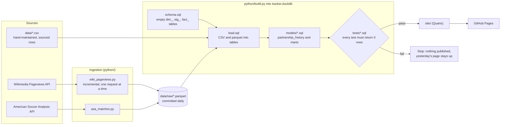

# MLS Partnership Tracker

**Health care is the biggest buyer of MLS sponsorship.** 7 of the 30 clubs
wear a hospital or health system on the front of the shirt, more than any
other category (8 of 32 front-of-kit deals; FC Dallas has a different one on
each kit). Counting sleeves and stadium names too, 14 of 30 clubs sell at
least one of those assets to a health care brand. Banks lead stadium naming,
with 6 of the 25 named stadiums, and BMO is on the front of three clubs'
kits (LAFC, Toronto, Montréal).

<sub>Deals current on 2026-11-13, from `mart_category_share` in
[`sql/models/40_category_landscape.sql`](sql/models/40_category_landscape.sql).
Brand categories are this project's own, set in
[`data/brands.csv`](data/brands.csv) and defined in
[`data/categories.csv`](data/categories.csv).</sub>

**[See the live page](https://chrisantosiewicz.github.io/MLS-partnership-tracker/)**

## What this is

A sourced, versioned dataset of MLS club sponsorships, plus a daily pipeline
that tracks public attention (Wikipedia pageviews) for each club and sponsor
brand. It powers the sponsorship page of Chris Antosiewicz's portfolio site.

> **Status:** dataset v0.1 is complete for 2026. It covers front-of-kit
> partners for all 30 clubs, sleeve partners for the 26 clubs that sell one
> (the other 4 carry only the league-wide Apple TV patch), and stadium naming
> rights for the 25 clubs whose stadium name is sold.

Every row cites a source. Pageviews measure public attention, not what a
sponsorship is worth, and deal values appear only where a source reported
one.

## How it works



GitHub Actions runs the whole chain daily at 09:17 UTC
(`.github/workflows/daily.yml`). If any data test fails, nothing is published
and the previous page stays up. The tables, their keys and how they join are
in the [data model](docs/DATA_MODEL.md).

| Folder | What's in it |
|--------|--------------|
| `data/` | Hand-maintained CSVs and the [data dictionary](data/README.md); `raw/` holds API data |
| `sql/` | `schema.sql`, `load.sql`, and `models/` (history, attention baseline, match-day lift, category landscape) |
| `tests/` | Data tests: queries that must return zero rows. `tests/python/` has unit tests |
| `python/` | Ingestion scripts and the build runner |
| `site/` | Quarto page and chart code |
| `docs/` | [Data model](docs/DATA_MODEL.md) (ERD), plus project tracking: progress log, skill tracker, decisions, [walkthrough](docs/WALKTHROUGH.md) |

## Run it locally

```bash
python -m venv .venv
source .venv/bin/activate          # Windows: .venv\Scripts\activate
pip install -r requirements.txt

python python/wiki_pageviews.py    # fetch pageviews (first run backfills from 2023)
python python/asa_matches.py       # fetch MLS matches
python python/build.py             # build tracker.duckdb and run every data test
pytest -q tests/python             # unit tests for the ingestion code
quarto render site                 # build the page into site/_site/
```

## Sources and credits

- **Sponsorship rows:** each row cites its source in `source_url`, with the
  date it was checked.
- **Pageviews:** [Wikimedia Analytics API](https://doc.wikimedia.org/generated-data-platform/aqs/analytics-api/),
  released under CC0. Requests send a descriptive User-Agent and run one at a
  time, per Wikimedia's access policy. Pageviews are a proxy for public
  attention, not sponsor value.
- **Matches:** [American Soccer Analysis](https://www.americansocceranalysis.com/)
  via the `itscalledsoccer` package. Thanks to ASA for a free, public API.

## License

Code: [MIT](LICENSE). Dataset files in `data/`: [CC BY 4.0](data/LICENSE.md).

## Project tracking

- [`CHANGELOG.md`](CHANGELOG.md): dataset and pipeline changes
- [`docs/PROGRESS_LOG.md`](docs/PROGRESS_LOG.md): weekly plan and what got done
- [`docs/SKILL_TRACKER.md`](docs/SKILL_TRACKER.md): skills practiced, with evidence
- [`docs/DECISIONS.md`](docs/DECISIONS.md): standing design decisions
- [`data/TO_VERIFY.md`](data/TO_VERIFY.md): sponsorship rows waiting on sources

Each folder has a short `CONTEXT.md` saying what it's for and how to work in
it; [`CLAUDE.md`](CLAUDE.md) routes between them.
