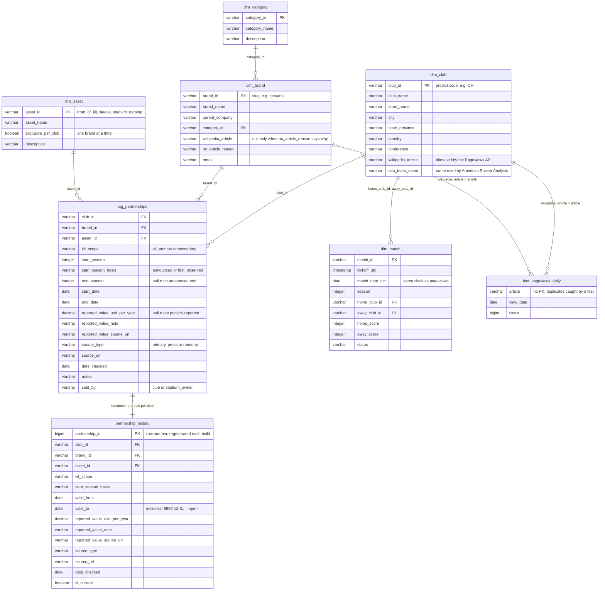
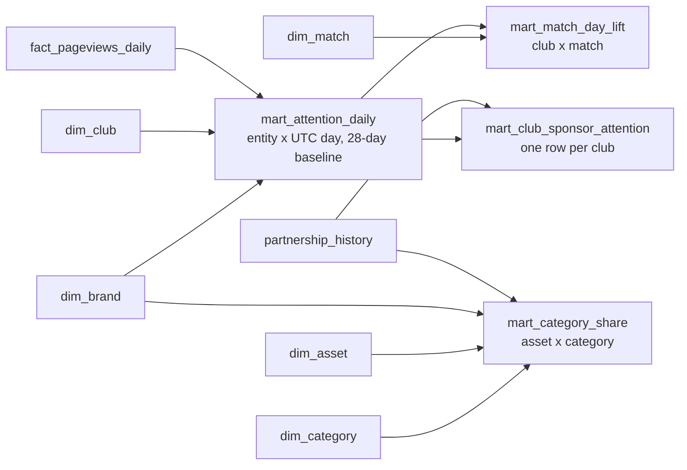

# Data model

Every table lives in one DuckDB file, `tracker.duckdb`, rebuilt from scratch
by `python/build.py` on each run. Column lists below match
[`sql/schema.sql`](../sql/schema.sql) and [`sql/models/`](../sql/models/).

## Layers

| Prefix | Built by | Grain |
|--------|----------|-------|
| `dim_` | `schema.sql` + `load.sql` | One row per thing: club, brand, category, asset, match |
| `stg_` | `schema.sql` + `load.sql` | The hand-maintained CSV as typed rows, before business rules |
| `fact_` | `schema.sql` + `load.sql` | One row per measurement: article per UTC day |
| `partnership_history` | `models/10_partnership_history.sql` | One row per deal, with `valid_from` / `valid_to` dates (type 2 SCD) |
| `mart_` | `models/20` to `models/40` | Tables the page reads |

## Entity relationship diagram

Primary keys on the `dim_` tables are enforced. Foreign keys are **not declared**: each line below
is checked by a data test in [`tests/`](../tests/) instead, so a bad row
shows up in the test report rather than crashing the load.

## Marts

The marts are derived tables the page reads. They're kept out of the diagram
above so it stays readable.

| Mart | Grain | Answers |
|------|-------|---------|
| `mart_attention_daily` | One row per club or brand per UTC day | Daily pageviews against the trailing 28-day baseline |
| `mart_match_day_lift` | One row per club per match | How far a club's pageviews rise on match day |
| `mart_category_share` | One row per asset per category | Which categories buy each asset, among current deals |
| `mart_club_sponsor_attention` | One row per club | Attention its current sponsor brands get, last 28 days |

Pageviews are a proxy for public attention, never sponsor value.

## Notes on the joins

- **Pageviews join on article title**, not an id: `dim_club.wikipedia_article`
  and `dim_brand.wikipedia_article` match `fact_pageviews_daily.article`.
  `mart_attention_daily` stacks clubs and brands into one table with
  `entity_type` and `entity_id`.
- **As-of questions** use `partnership_history`:
  `WHERE DATE '2025-06-01' BETWEEN valid_from AND valid_to`. See
  [`sql/examples/as_of_kit_partner.sql`](../sql/examples/as_of_kit_partner.sql).
- **`sold_by`** stays in `stg_partnerships` and isn't carried into
  `partnership_history` yet.
